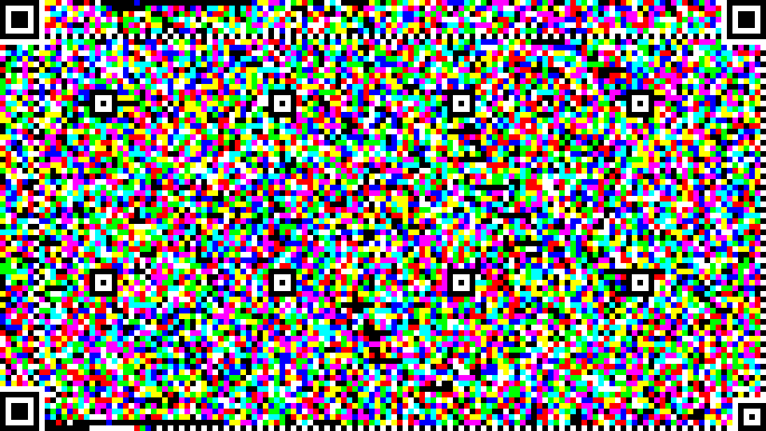
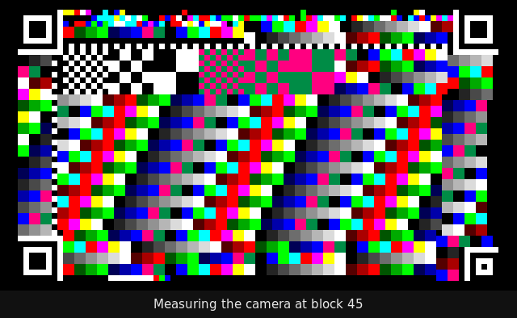
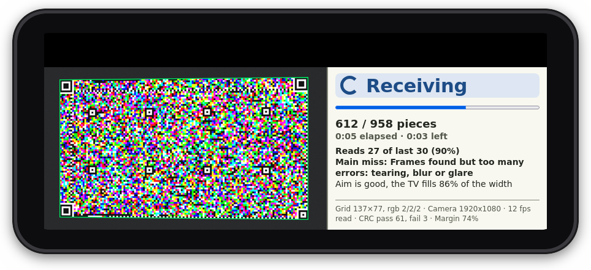
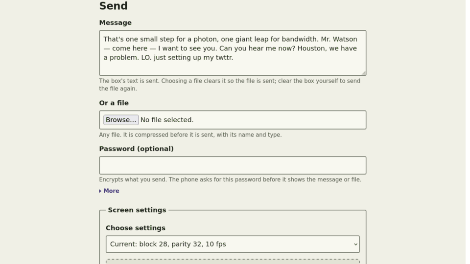

# Visual Modem

[](https://github.com/StephenGenusa/VisualModem/actions/workflows/test.yml)
[](LICENSE)


Visual Modem sends files and messages from one screen to a phone camera using nothing but light. The sender shows the data as a grid of colored blocks, full screen. The phone reads it through its camera in the browser and rebuilds the file, checked byte for byte. There is no network, pairing, cable or app install, and any number of phones can watch the same screen at once.

After building [shotmodem](https://github.com/StephenGenusa/shotmodem), I started thinking about other novel uses of photons for communications. I have experimented with modulated lasers carrying information, and I am interested in every form of communication: words carrying meaning and connotation, RF, data communications, modems, ICMP, TCP/IP. This was a natural avenue to follow. I wanted to see what I could put together, and what data rates I could reach, without a large investment of time.



*One frame of a 200 KB file at block 28 on a 4K screen: corner markers, timing strips on all four edges, alignment patterns, and 14 packets of data.*

## See it in action

**Probe**, half a loop at real speed. The phone measures each block size, color scheme and frame rate, then recommends the best setting:



**The phone during a transfer**, held sideways. The camera view keeps its bottom edge on screen, and the panel beside it shows progress, read quality and an aim hint:



## What it achieves

Measured on one test setup: a 4K TV as the sender, and a phone browser reading with its camera at 1080p, from about where a person would sit.

| Setting | Result |
|---|---|
| 200 KB file, block 28, 8-color cube, 10 frames a second, fountain coding | complete in 8.3 to 8.9 s, about 23 KB/s, with under 1% extra pieces |
| The same file with the phone handheld, about 20 degrees off-square | complete in 9.7 s |
| Still frames at an angle, with all four corners in view | read at up to 45 degrees to one side and 25 to the other; 35 to the other side read only partly |
| The same file without fountain coding (version 3 frames) | 18 s, and up to 88 s when one frame keeps being missed |
| A probe run's best measured setting (block 28, 8-color cube, 10 fps) | about 30 KB/s |
| A hand over one timing edge of the grid during a run | every read still works |
| Block 19, where no whole frame ever read | about 15 KB/s from partly read frames |

These numbers depend on the screen, the camera, the room and the aim. The built-in Probe measures your own setup.

## How it works

1. **Payload.** The message or file is compressed with gzip, optionally encrypted with AES-256-GCM (PBKDF2-SHA-256, 200,000 rounds), and fingerprinted with SHA-256.
2. **Packets and fountain coding.** The stream is cut into pieces. The sender shows the pieces themselves, then an endless supply of repair pieces, each a random mix of the source pieces (a dense GF(2) fountain code). A phone needs any set of pieces slightly larger than the file, so it can start at any moment and every frame it reads helps. Files over 1,024 pieces go out as version 3, where every frame comes round once per loop.
3. **Frames.** Each frame carries a 24-byte header, drawn twice in a robust 8-color code, and as many packets as fit. Each packet is a Reed Solomon codeword with its own CRC-16, so a frame torn by the camera's rolling shutter still gives up its intact packets. The payload is split into equal codewords of at most 255 bytes, so no part of the frame is wasted.
4. **The grid.** The grid has three large corner markers and a small fourth one, timing strips of alternating blocks along all four edges, a calibration strip of reference colors, alignment patterns and pilot cells. Data cells hold 1 to 6 bits each, depending on the color scheme.
5. **Reading.**
   - The phone finds the markers and maps the tilted view back to a flat grid. At an angle the far markers look smaller and dimmer, so if the first search fails, it scores sets of four markers by how well their sizes fit the perspective. It then tries whichever search worked last first.
   - It checks the grid size against the timing strips, correcting for lens bend. If one strip is covered, it uses the strip on the opposite edge instead.
   - It calibrates the colors from the reference strip, undoes the camera's color mixing, and samples every cell.
   - It repairs each codeword and keeps the packets whose CRC passes.
   - It solves for the source pieces, then checks the SHA-256.
6. **Measuring.** Probe frames carry a known pattern, so the phone can score every block size, color scheme and frame rate by the good packets it actually reads, and recommend the best setting for where it stands.

The payload always travels by light. The optional network path (`npm run capture`) carries only measurements and debug reports, used by Auto tune, the test runner and development.

## Quick start

Use Node 22.

```
npm install
npm test
```

Phone cameras only work on secure pages, so the server uses HTTPS. Generate certificates with [mkcert](https://github.com/FiloSottile/mkcert) into `certs/` (`cert.pem` and `key.pem`) naming the computer's address, and install the mkcert root certificate on the phone. Then:

```
npm start            # serve the app
npm run capture      # serve it, and also accept the phone's measurements and debug reports
```

Open `https://<your-computer-address>:8443/web/` on the sending computer. Open the same address with `#receive` on the phone, or scan the QR code at the bottom of the Send page.

A tunnel such as cloudflared also gives a public HTTPS address for the local server.

### A hotspot from the computer

When there is no shared Wi-Fi, the computer can be the network. Its Wi-Fi card runs as an access point, hands out addresses and routes traffic out the wired connection. By default the computer is at `192.168.12.1` on the hotspot, so the certificate must name that address: `mkcert -cert-file certs/cert.pem -key-file certs/key.pem 192.168.12.1 localhost`.

The script wraps `create_ap` from [linux-wifi-hotspot](https://github.com/lakinduakash/linux-wifi-hotspot). NetworkManager's built-in hotspot fails with some Wi-Fi drivers: phones fail with "Unable to join the network" because the driver drops the replies to them. If your distribution has no package for create_ap, install it from source:

```
sudo apt install hostapd iw git
git clone https://github.com/lakinduakash/linux-wifi-hotspot.git ~/src/linux-wifi-hotspot
cd ~/src/linux-wifi-hotspot/src/scripts && sudo make install
```

Set `VM_IFACE` to the Wi-Fi interface and `VM_UPLINK` to the wired one (defaults `wlan0` and `eth0`). If ufw is on, let the hotspot through: `sudo ufw allow in on <wifi>` and `sudo ufw route allow in on <wifi> out on <wired>`.

* `sudo tools/hotspot.sh start` asks for a password and starts the hotspot `VisualModem` in the background.
* `tools/hotspot.sh status` shows the joined phones and their addresses.
* `sudo tools/hotspot.sh stop` stops it.

## Sending



The Send page has a short help line under every control, and a "More" link that rolls down the trade-offs and what works well together. Six color chips at the top pick the page's theme; until you pick one, it follows the computer's dark mode setting.

1. Type a message, or choose a file. The message box starts with a sample message; choosing a file clears it so the file is sent.
2. Optionally type a password. The receiver must then type the same password.
3. Set the screen settings:
   * **Block size:** the width of one block in pixels. Bigger blocks read from farther away but carry less.
   * **Color scheme and levels:** how a block's color carries bits. The 8-color cube (2 levels per channel) carried the most in testing. Black and white is the safest at small blocks. The receiver needs no setting, because every frame's header names its scheme.
   * **Fountain coding:** on by default. Leave it on for live sending.
   * **Parity:** error correction per codeword. 32 is the measured default.
   * **Frames per second:** how fast frames change. Fountain coding is what makes the higher rates pay.
   * **White level:** dims the whole frame for a bright or glossy screen.
4. Read the readout line. It shows the packets per frame and the number of source frames, or says why the data does not fit.
5. Press **Start**. The grid fills the screen and loops until you press Escape, click or tap it.

Instead of showing the frames, **Save as PNG files** writes them as images, with their own size and settings. Open them on the Receive page with Open files.

The Send page groups its actions:

* **Send:** Start, and saving PNG files. No network needed.
* **Find the best settings:** Probe. No network needed.
* **Development and testing:** Auto tune and Run tests. These appear only with `npm run capture`.

## Receiving

1. Open the Receive page and allow the camera. Hold the phone sideways, with the screen centered and filling 85 to 90% of the view. A tripod helps.
2. The camera view fills the phone's height, so you can always see the bottom edge of what the camera sees. The panel beside it shows:
   * the state, large enough to read from a distance;
   * progress, with elapsed and remaining time;
   * the share of recent reads that worked, the main reason reads fail in plain words, and an aim hint;
   * small details: grid size and colors, camera size, read rate, CRC counts and margin.
3. If the data is encrypted, a password box appears.
4. When the file is complete, it appears with Save (and Share on phones that support it). A message appears with Copy.

The panel moves under the camera when the phone is held upright. Tabs, camera size, Open files and Reset are below, reached by scrolling.

## Probe and setup check

Probe finds the setting that moves the most data by light alone, for the phone where it stands. It needs no network: the sender only shows frames, and the phone measures and recommends. Any number of phones can watch the same run.

1. Put the phone on the Receive page, pointed at the screen.
2. Choose the number of loops and press **Probe**.

The screen steps through block sizes from 45 down to 9. Each size starts with a characterization frame, then shows one probe per color scheme and a static twin. A frame rate sweep at blocks 35 and 28 follows, at 4 to 15 frames a second. One loop takes about 160 seconds.

The phone scores each probe by the distinct good packets it reads per second. It also reports the **partial gain**: how much more partly read frames deliver than whole frames alone. At the end it shows a recommendation such as "Use block 28, Color cube, 2 levels, 10 frames per second. About 30.0 KB/s here."

The Setup check panel, further down the Receive page, shows:
* aiming advice;
* a camera profile per block size;
* the best probes;
* the recommendation.

With `npm run capture`, the phone also posts every probe's numbers, and a record of each read, to `test/photos/debug.jsonl`. `node tools/probe-report.js [--since <ISO time>] test/photos/debug.jsonl` tabulates them.

## Development tools

These need `npm run capture`, which lets the phone report back to the computer. They measure; they never carry the payload.

* **Auto tune** shows test frames, steps the block size down until reads fail, and sets the smallest block size that reads reliably at 2 and at 4 levels.
* **Run tests** runs Auto tune at each phone camera size (1080p and 4K), then times a file at several frame rates, and shows a report table.
* **Send camera frame to computer** on the Receive page saves one camera image on the computer, for `node tools/decode-photo.js <image>`.

## Code layout

| Folder | What it holds |
|---|---|
| `src/core` | Bytes to frames and back: payload packing, compression, encryption, Reed Solomon, CRC, the fountain code, the version 3 and 4 frame formats, transmission and collection |
| `src/picture` | Frames to pixels and back: grid layout, rendering, the exact PNG reader, the marker finder, the homography, and the camera reader |
| `src/optimize` | Probe frames and their known patterns, the scorer, error measurement, aiming advice and the camera characterization frame |
| `src/tune` | Auto tune and the test runner's logic |
| `src/testutil` | Image I/O and a camera simulator (tilt, lens bend, blur, brightness, color cast, noise) for tests |
| `web` | The page: Send and Receive tabs, the full screen stage, the camera, the background reader, the phone's run panel, themes |
| `web/vendor` | qrcode-generator 1.4.4 (MIT), served locally so the page works offline |
| `tools` | The HTTPS server, the probe report, the photo decoder, the hotspot script |
| `utils` | Developer scripts: rebuilding the README images (`make-readme-images.sh`), the GIF encoder and timing checks |
| `images` | The README images |
| `test` | One test file per module, run by `npm test` |
| `docs` | Design specs and the implementation plans for each stage |

`src` has no DOM code. Everything there runs in Node and is tested there.

## Browsers

* Safari on iOS 16.4 and newer.
* Chrome on Android, 2023 and newer.
* A desktop browser on the sending computer. Full screen works best on the display that shows the grid.

## Test photos

Put photos of the screen in `test/photos/` to add them to the photo regression test. Image files, `.expected` files and the debug log there are ignored by git. See `test/photos/README.md`.

## License

MIT. See [LICENSE](LICENSE). `web/vendor/qrcode.js` is qrcode-generator by Kazuhiko Arase, also MIT.
